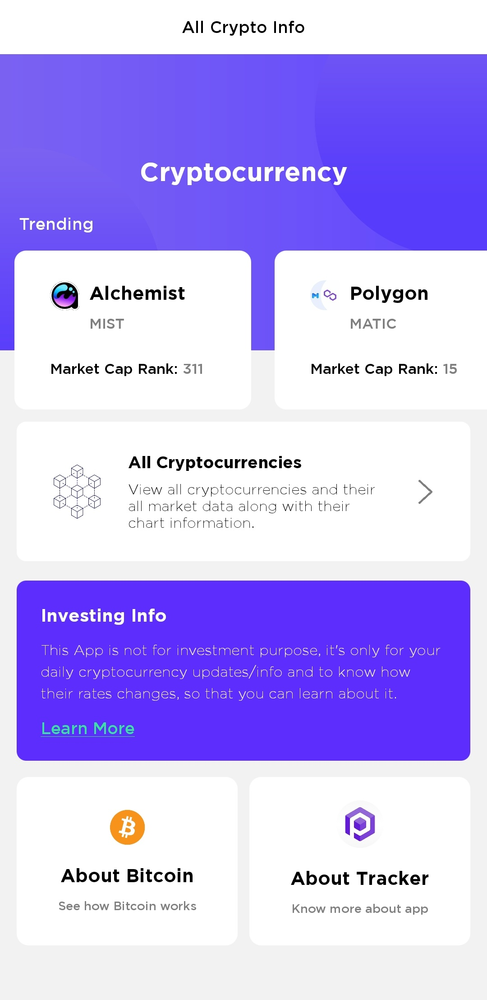
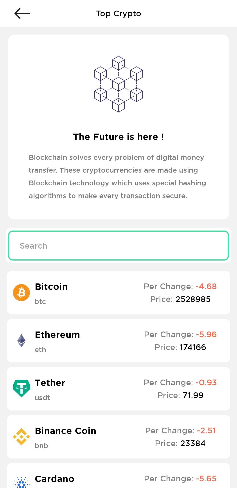
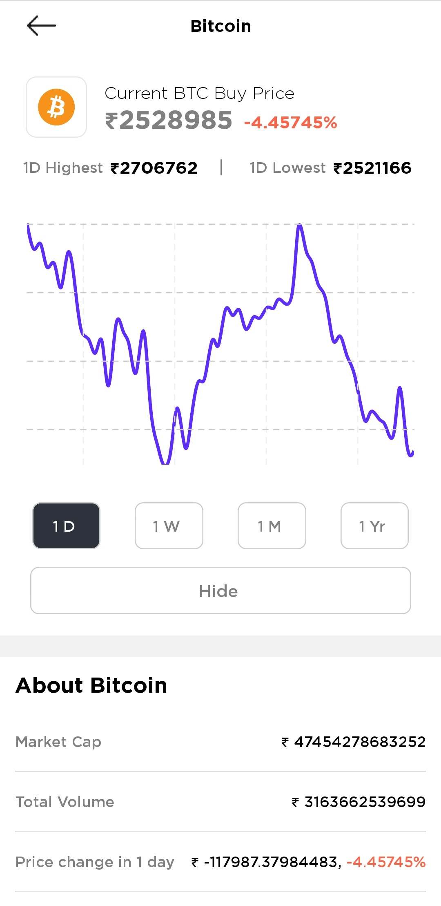
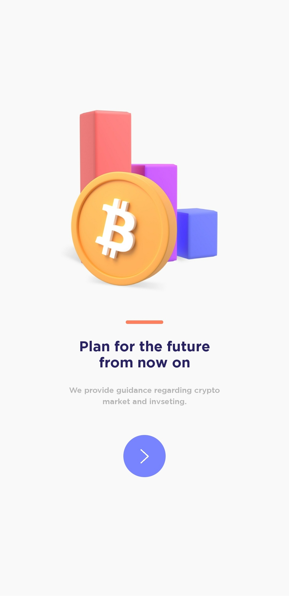

<div align="center">

# Crypto Tracker

Live prices, charts and plain-language guides for the top cryptocurrencies.

    

</div>

<table>
  <tr><th>Home</th><th>Top 100</th><th>Coin details</th></tr>
  <tr><td></td><td></td><td></td></tr>
</table>

## About

Crypto Tracker is an Android app for following the cryptocurrency market. It lists the top 100 coins by market cap with live prices in Indian rupees, shows interactive price charts for each coin, and explains how Bitcoin and blockchain work for people who are new to crypto. All market data comes from the free [CoinGecko API](https://www.coingecko.com/en/api), so it needs no API key.

## Screenshots

| Welcome | About Bitcoin |
| :---: | :---: |
|  |  |

## Features

- **Home**: trending coins, shortcuts to the top 100 list and exchange rates, and learning resources
- **Top 100**: the top cryptocurrencies by market cap with price and 24-hour change, plus search
- **Coin details**: current price, daily high and low, market cap, volume and an interactive chart for 1 day, 1 week, 1 month or 1 year
- **About Bitcoin**: an illustrated guide to Bitcoin, blockchain, mining and wallets
- **Personal touch**: greets you by the name you enter on the welcome screen

## Tech Stack

| Area | Technology |
| --- | --- |
| App | React Native 0.64, React 17 |
| Navigation | React Navigation (stack) |
| Charts | Victory Native, react-native-svg |
| Data | CoinGecko API (prices in INR) |

## Getting Started

**Prerequisites:** a [React Native development environment](https://reactnative.dev/docs/environment-setup) for Android (Node.js, JDK and Android Studio)

```bash
cd CryptoTracker
npm install
npx react-native run-android
```

For a signed release build, add your own `MYAPP_UPLOAD_*` keystore settings to `~/.gradle/gradle.properties`. They are not stored in this repository.

## Project Structure

```
.
├── CryptoTracker/
│   ├── App.js           # navigation stack
│   ├── screens/         # Welcome, Home, Top100, CryptoInfo, AboutBitcoin, About, Portfolio
│   ├── assets/          # images and fonts
│   └── android/         # native Android project
└── Images/              # README screenshots and graphics
```
